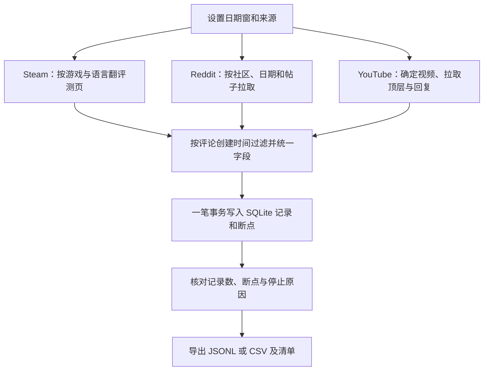

# 三平台采集流程

## 共用口径

- `collection.start` 包含起点，`collection.end` 排除终点。SQLite 时间为 UTC。按北京时间统计时，以当地零点换算两个边界。评论创建日期决定入库窗口，帖子和视频可能早于窗口。
- 主键是 `(platform, kind, native_id)`。再次遍历会更新已有记录。作者 ID 通过平台域内 HMAC 转成假名，`root_id` 指向游戏、帖子或视频，`parent_id` 记录回复关系。各平台的点赞、评论分数与引用计数沿用原义。
- `status` 可查看库内计数、各采集任务的断点和最近运行。相同配置续跑。变更相关日期、来源或筛选条件会生成新的任务范围，旧记录仍会留在同一数据库。`--restart` 重遍当前任务范围，也会更新相同主键。对同一任务键使用单个写入进程。
- 网络层按 `min_interval` 节流，对可重试故障退避。页数据与游标一起提交。研究校验以 SQLite 中的去重记录数为准，单次运行的保存数可包含更新。任务的 `complete` 表示相应来源和查询已到停止条件。
- `export` 仅按平台和记录类型筛选，导出清单中的 `collection` 是运行时配置。CSV 对可能触发公式求值的文本做转义，JSONL 保留正文字段。作者假名化的记录仍需由项目组保存。

## Steam

入口为 `collect steam`，实现见 [steam.py](../src/wukong_collect/steam.py)。默认取 App ID `2358720`、全语言、全部推荐状态和购买类型，每页至多 100 条。

1. 调 `IUserReviewsService/GetAppReviews/v1/`，按创建时间靠后的评测先翻页。程序将窗口终点转换为 Steam 使用的秒级包含上界，并在客户端再次检查创建时间。
2. 用 `cursor="*"` 开始。每页保存评测和返回的下一游标。遇到空页或整页早于起点即停止。非空页的游标停滞会报告错误并保留可重试断点。
3. 保存 Steam 提供的语种、推荐状态 `voted_up`、有用票数和可用的游戏时长字段。拿独立窗口按日或按周重跑，可覆盖长窗口翻页后留下的样本缺口。

Steamworks 的公开评测接口有独立的参数说明。当前实现使用上述 Web API 端点。 [Steamworks 评测文档](https://partner.steamgames.com/doc/store/getreviews)

## Reddit

入口为 `collect reddit`。默认使用 [reddit_archive.py](../src/wukong_collect/reddit_archive.py)，按 UTC 秒向 Arctic Shift 读取档案。

1. 对 `archive_all_comments_subreddits` 中的专门社区直接拉该社区在窗口中的评论。给 `subreddits` 加入泛社区时，先用 `keywords` 搜索主题帖，再按帖子 ID 拉各帖的评论，以保留正文未出现关键词的回复。父帖搜索起点由 `archive_posts_start` 控制。
2. 当返回达到档案单页容量或遇到可拆分的查询超时，程序二分时间片后重试。若最小的秒级窗口仍饱和，记录阻塞时间片，以便人工查看及调整。可选的 `archive_page_mode = "auto_time"` 会保留返回页尾的整秒，在下一次重新查询。
3. 将帖子 ID、父级 ID、社区和 `metadata.source` 写入规范记录。归档的可见性及覆盖范围需与样本一起说明。 [Arctic Shift API 文档](https://github.com/ArthurHeitmann/arctic_shift/blob/master/api/README.md)

可选的 [reddit.py](../src/wukong_collect/reddit.py) 适配 BigQuery 或 JSONL/CSV 导入。BigQuery 从具备读取权限、实际存在的表中查询，保存查询作业 ID 和行偏移，分批读取同一作业的结果。若查询结果已过期，需要用 `--restart` 重新查询。使用 `reddit-schema` 核对字段，`reddit-query` 预览参数化查询，开启字节扫描预算。导入模式按配置字段映射逐批读文件，以文件校验值和行号续跑。配置示例见 [凭据与可选数据源](credentials.md)。

## YouTube

发现入口为 `youtube-discover`，评论入口为 `collect youtube`，实现见 [youtube.py](../src/wukong_collect/youtube.py)。

1. 在 `video_ids` 填写筛过的种子视频，或使用 `search.list` 按关键词分页发现候选。候选视频存在当前库里，采集时和显式 ID 合并。可用 `published_after` / `published_before` 约束候选视频的发布时间。
2. 用 `videos.list` 获取视频信息，按视频用 `commentThreads.list` 分页拉取顶层评论。按照评论各自发布时间应用窗口。
3. `include_replies=true` 时，从线程内可确认齐全的嵌入回复直接入库，其余父评论进入待补回复队列，使用 `comments.list(parentId=...)` 翻页。顶层、待补回复及分页令牌会随入库保存。早于窗口的父评论仍可能有窗口内的新回复。
4. 关闭评论或失效的视频会记录停止原因。请求预算或外部配额耗尽时，从已提交的断点继续。同一轮续采会跳过已成功获取元数据的视频批次。到 Google Cloud 控制台核对实际配额。 [顶层线程](https://developers.google.com/youtube/data/reference/rest/v3/commentThreads/list) · [回复](https://developers.google.com/youtube/data/reference/rest/v3/comments/list) · [配额](https://developers.google.com/youtube/data/determine_quota_cost)

## 本项目的历史补采

以下脚本用于记录中期项目的补采策略。脚本会联系相应数据源并写入配置指向的库。从已完成首轮采集并保有候选视频的研究库运行，才能形成同类的补采计划。

| 脚本 | 用法与采样策略 |
| --- | --- |
| `scripts/collect_steam_large.py` | 批量执行 Steam 主链路，保存进度，遇低磁盘空间停止。批大小由 `--batch-pages` 控制。运行时使用独立库，避免旧窗口的断点被合并到历史脚本的进度估计中。 |
| `scripts/collect_full_cycle.py` | 参数为 `steam`、`reddit` 或 `youtube`。Steam 在缺口周抽选日期。Reddit 先跑六个试采周，再用 `reddit --expand-weeks` 扩展至稀疏周，单周最多新增 150 条。YouTube 按稀疏月份选视频，每视频最多新增 150 条且至多 12 页。 |
| `scripts/collect_remaining_gaps.py` | 参数同上。补齐全周期仍空白的 Steam、Reddit 日期，并优先为 YouTube 稀疏月份选补采视频。Steam 首发段目标 120 条/天，其余缺日最多 40 条。Reddit 空白日最多新增 3 条。YouTube 每视频最多新增 100 条且至多 8 页，可加 `--discover-youtube` 扩充候选。 |

两个中期脚本按北京时间将 2024-08-20 至 2026-11-08 作为固定边界。YouTube 补采只纳入当页所带的嵌入回复。要翻完回复队列时，运行正式 `collect youtube` 链路。使用历史补采脚本累计的计数需要保留采样上限和起始数据库作为统计口径。
